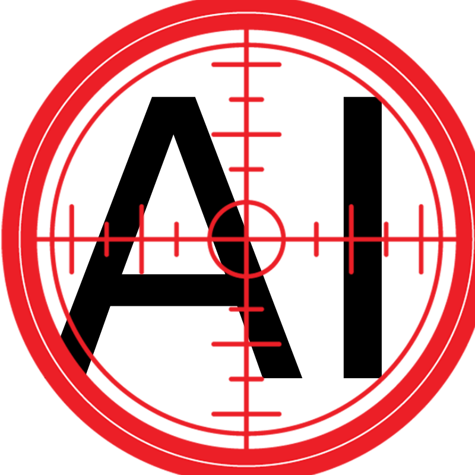
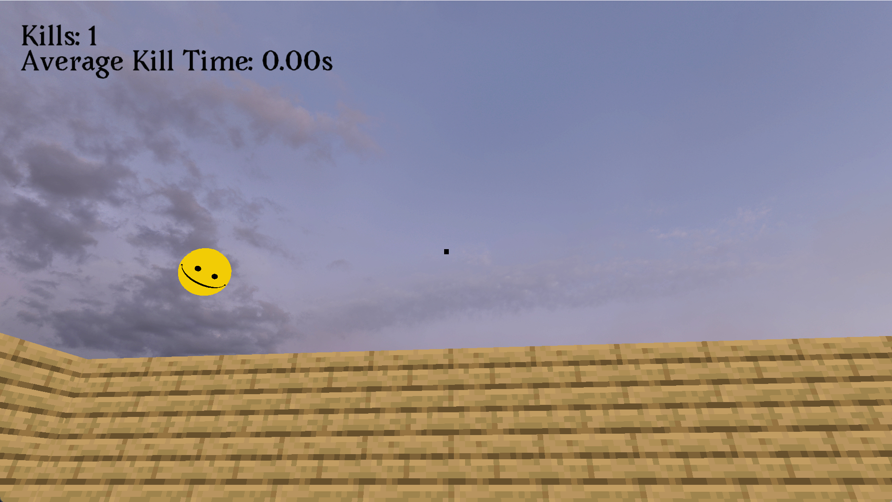
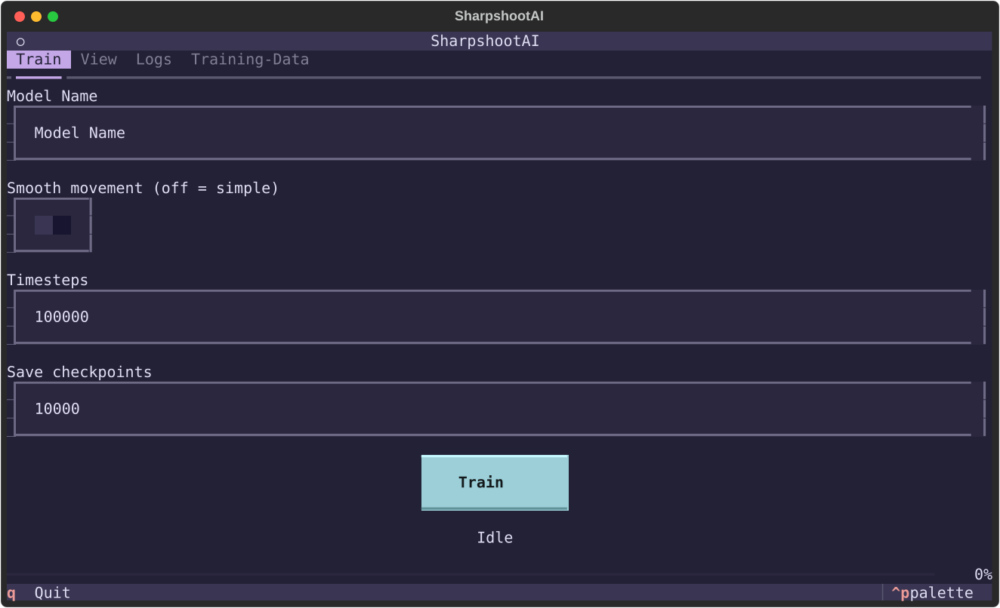
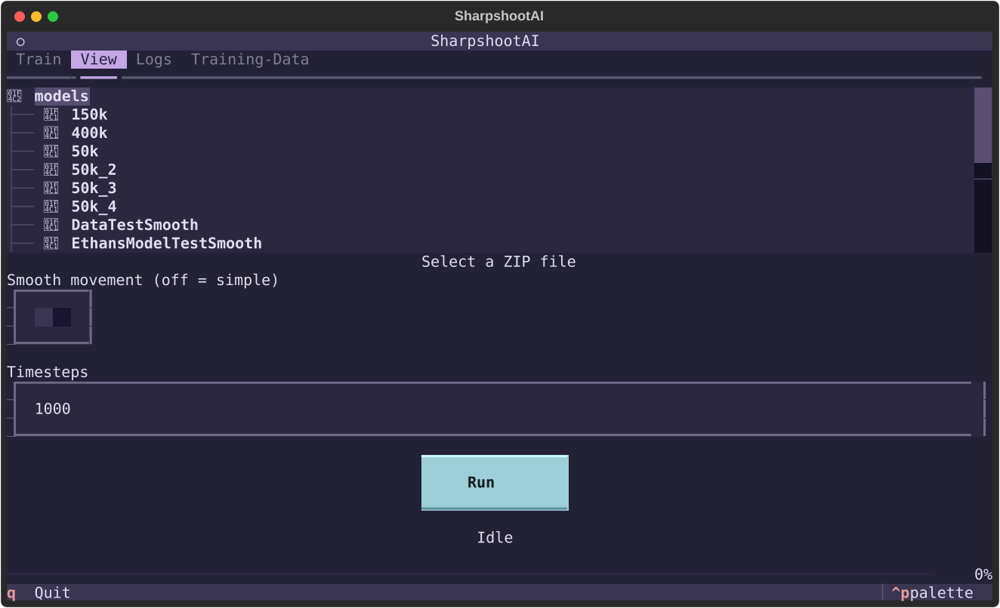

<!-- Improved compatibility of back to top link: See: https://github.com/othneildrew/Best-README-Template/pull/73 -->
<a id="readme-top"></a>
<!--
*** Thanks for checking out the Best-README-Template. If you have a suggestion
*** that would make this better, please fork the repo and create a pull request
*** or simply open an issue with the tag "enhancement".
*** Don't forget to give the project a star!
*** Thanks again! Now go create something AMAZING! :D
-->


<!-- PROJECT SHIELDS -->
<!--
*** I'm using markdown "reference style" links for readability.
*** Reference links are enclosed in brackets [ ] instead of parentheses ( ).
*** See the bottom of this document for the declaration of the reference variables
*** for contributors-url, forks-url, etc. This is an optional, concise syntax you may use.
*** https://www.markdownguide.org/basic-syntax/#reference-style-links
-->
[![Contributors][contributors-shield]][contributors-url]
[![Forks][forks-shield]][forks-url]
[![Stargazers][stars-shield]][stars-url]
[![Issues][issues-shield]][issues-url]
[![LinkedIn][linkedin-shield]][linkedin-url]


<!-- PROJECT LOGO -->
<br />
<div align="center">
  <a href="https://github.com/EthansCoding/SharpshootAI">
    
  </a>

<h3 align="center">SharpshootAI</h3>

  <p align="center">
    ML powered aimbot! 5 layers of DL to lock on! 
    <br />
    <a href="https://github.com/EthansCoding/SharpshootAI"><strong>Explore the docs »</strong></a>
    <br />
    <br />
    <a href="https://github.com/EthansCoding/SharpshootAI">View Demo</a>
    &middot;
    <a href="https://github.com/EthansCoding/SharpshootAI/issues/new?labels=bug&template=bug-report---.md">Report Bug</a>
    &middot;
    <a href="https://github.com/EthansCoding/SharpshootAI/issues/new?labels=enhancement&template=feature-request---.md">Request Feature</a>
  </p>
</div>


<!-- TABLE OF CONTENTS -->
<details>
  <summary>Table of Contents</summary>
  <ol>
    <li>
      <a href="#about-the-project">About The Project</a>
      <ul>
        <li><a href="#built-with">Built With</a></li>
      </ul>
    </li>
    <li>
      <a href="#getting-started">Getting Started</a>
      <ul>
        <li><a href="#prerequisites">Prerequisites</a></li>
        <li><a href="#installation">Installation</a></li>
      </ul>
    </li>
    <li><a href="#usage">Usage</a></li>
    <li><a href="#roadmap">Roadmap</a></li>
    <li><a href="#contact">Contact</a></li>
    <li><a href="#acknowledgments">Acknowledgments</a></li>
  </ol>
</details>


<!-- ABOUT THE PROJECT -->
## About The Project

SharpshootAI is the leading answer to being bad at video games. By leveraging state of the art python importing skills I have created the leading way to cheat in video games. If you simple feed this model that you train yourself the angle to the enemy it will lock on and start blasting away.

<details>
<summary>Images</summary>







</details>

<p align="right">(<a href="#readme-top">back to top</a>)</p>


### Built With

* [![Python 3.14][Python]][Python-url]
* [![uv][uv]][uv-url]
* [![Visual Studio Code][vs-code]][vs-code-url]
* [](https://gymnasium.farama.org/)
* [](https://stable-baselines3.readthedocs.io/)

<p align="right">(<a href="#readme-top">back to top</a>)</p>

<!-- GETTING STARTED -->
## Getting Started

Installation is very simple. Just install uv and python and clone to get started.

### Prerequisites

* UV [Install Instructions](https://docs.astral.sh/uv/getting-started/installation/)
* Python 3.14
  ```sh
  uv python install 3.14
  ```

### Installation

1. Clone the repo
   ```sh
   git clone https://github.com/EthansCoding/SharpshootAI.git
   ```
2. Initialize and install uv packages
   ```sh
   uv init
   uv sync
   ```
3. Start venv
   MacOS / Linux
   ```sh
   source .venv/bin/activate
   ```
   Windows (PowerShell)
   ```sh
   .venv/Scripts/activate
   ```
   Windows (cmd.exe)
   ```sh
   .venv\Scripts\activate.bat
   ```


<p align="right">(<a href="#readme-top">back to top</a>)</p>


<!-- USAGE EXAMPLES -->
## Usage

Use this space to show useful examples of how a project can be used. Additional screenshots, code examples and demos work well in this space. You may also link to more resources.

There are two ways to run this program.

The first is Sharpshoot TUI

1. Launch SharpshootTUI
   ```sh
   python SharpshootTUI.py
   ```
2. Train a model
   * Input a Model Name: e.g 150kSmooth (Recommended to include type of model in name.)
     Models are stored at path
     ```
     SharpshootAI/models/model_name
     ```
   * Choose smooth or simple movement (Smooth preferred)
     Simple uses 5 discrete inputs
     Smooth uses 3 continuous inputs (looks better)
   * Choose the number of timesteps
     The number of timesteps choosing how long to train a model for,
     typically the program runs at 300-1000 timesteps per second.
   * Choose how often to save checkpoints
     The number of checkpoints should fit easily into the total timesteps
     20k into 200k or 5k into 25k
   * When satisfied with params, hit the train button!
3. View your model
   * Navigate to the view pane
   * Choose a model in the directory, click on the zip file
   * Choose whether the model is a smooth or simple model
   * Choose how many time steps to simulate, running at 60 fps, 1000 is approx 15 seconds
4. (Optional if you have super good trained model)
   * Create data in the create data page
   * Train a DL model in the DL tab
   * Run that DL model.

The second way is through commands

1. Train
   * timesteps (optional): default 100,000
   * model-path (optional): path to folder to save model.zips into, default: models/ppo_aim_trainer
   * movement-type (optional): default "simple", can be "smooth" instead
   * save-checkpoints (optional): default 10,000
   ```sh
   python train.py --timesteps 200000 --model-path "/models/EthansModel" --movement-type "smooth" --save-checkpoints 50000
   ```
2. View
   * model: Path to the model folder
   * time (optional): default 1,000 the number of steps to simulate
   * movement-type (optional): default "simple" can be smooth instead
   ```sh
   python model_viewer.py "model" --time 1000 --movement-type "smooth"
   ```
3. Play (Optional)
   ```sh
   python play.py
   ```

Training Path for successful DL run:
  * Train 250k Params Simple Model
  * Check if it gets stuck in 5000 timesteps
  * Generate 10,000 lines of data
  * Check if data gets stuck
  * Train DL model on the 10000 lines with 5000e
  * Run that model

<p align="right">(<a href="#readme-top">back to top</a>)</p>

<!-- ROADMAP -->
## Roadmap

- [X] Functioning MVP
- [X] Terminal UI
- [ ] Addings Guns and polish game viewing.
- [ ] Model leader board within TUI

See the [open issues](https://github.com/EthansCoding/SharpshootAI/issues) for a full list of proposed features (and known issues).

<p align="right">(<a href="#readme-top">back to top</a>)</p>

## MVP
Create an ML model that can automatically aim at enemy targets.
The model will control a player that can only look L/R and U/D at constant rates.
It will be fed in the angle from its current looking direction to the goal direction.
Using that to move the camera to focus on the target. It will be rewarded for movement towards
the goal. Rewarded heavily for being on top of and aiming at the goal.

## MVP Timeline
1. Setup file structure project, git init, uv init, requirements.txt and readme.md
2. Setup aim_trainer.py. It should be a template 3d level.
3. Setup aim_trainer.py to be an aim trainer esque game. No movement, shoot spheres floating.
4. Build aim_trainer_env.py which is a gymnassium env that can run the game logic with / without rendering the game.
5. Add reward function to aim_trainer_env.py.
6.Create a train.py that uses SB3 with the gym and train for a suitable number of steps.
7. Create a model_runner.py file that runs the model specified by params and lets you watch a model play the aim trainer.
8. (Optional) Create a leaderboard of the models created so far. Create up to 5 models trained differently. Present which one turned out the best

<!-- CONTACT -->
## Contact

Your Name - eelliott505@gmail.com

Project Link: [https://github.com/EthansCoding/SharpshootAI](https://github.com/EthansCoding/SharpshootAI)

<p align="right">(<a href="#readme-top">back to top</a>)</p>


<!-- MARKDOWN LINKS & IMAGES -->
<!-- https://www.markdownguide.org/basic-syntax/#reference-style-links -->
[contributors-shield]: https://img.shields.io/github/contributors/EthansCoding/SharpshootAI.svg?style=for-the-badge
[contributors-url]: https://github.com/EthansCoding/SharpshootAI/graphs/contributors
[forks-shield]: https://img.shields.io/github/forks/EthansCoding/SharpshootAI.svg?style=for-the-badge
[forks-url]: https://github.com/EthansCoding/SharpshootAI/network/members
[stars-shield]: https://img.shields.io/github/stars/EthansCoding/SharpshootAI.svg?style=for-the-badge
[stars-url]: https://github.com/EthansCoding/SharpshootAI/stargazers
[issues-shield]: https://img.shields.io/github/issues/EthansCoding/SharpshootAI.svg?style=for-the-badge
[issues-url]: https://github.com/EthansCoding/SharpshootAI/issues
[license-shield]: https://img.shields.io/github/license/EthansCoding/SharpshootAI.svg?style=for-the-badge
[license-url]: https://github.com/EthansCoding/SharpshootAI/blob/master/LICENSE.txt
[linkedin-shield]: https://img.shields.io/badge/-LinkedIn-black.svg?style=for-the-badge&logo=linkedin&colorB=555
[linkedin-url]: https://linkedin.com/in/ethan-elliott-7a642b369
[product-screenshot]: images/Train.svg
<!-- Shields.io badges. You can a comprehensive list with many more badges at: https://github.com/inttter/md-badges -->
[Next.js]: https://img.shields.io/badge/next.js-000000?style=for-the-badge&logo=nextdotjs&logoColor=white
[Next-url]: https://nextjs.org/
[Python]: https://img.shields.io/badge/Python-3776AB?logo=python&logoColor=fff?style=for-the-badge
[Python-url]: https://www.python.org/
[uv]: https://img.shields.io/badge/uv-261230.svg?logo=uv&logoColor=#de5fe9?style=for-the-badge
[uv-url]: https://docs.astral.sh/uv/
[vs-code]: https://custom-icon-badges.demolab.com/badge/Visual%20Studio%20Code-0078d7.svg?logo=visualstudiocode&logoColor=white?style=for-the-badge
[vs-code-url]: https://code.visualstudio.com/
